 

 

  

  

  

<b>Engineering principles</b>

 

| Principle | In practice |
|---|---|
| **Evidence first** | Every fix starts from a traced root cause, never a guess |
| **Impact before edit** | Cross-repo consumers and affected features are checked before shared code changes |
| **Small slices** | One shippable change per PR, squashed into `develop` |
| **Linear releases** | Release branches are `main` + cherry-picks — no merge noise |
| **Verified, not assumed** | Reviewed, QA-tested and smoke-checked on a deployed environment |
| **Safe data changes** | Migrations proven inside transactions; snapshot & restore on shared DBs |

 

  

 

 

  
<picture>
  <source media="(prefers-color-scheme: dark)" srcset="https://raw.githubusercontent.com/dokhaidfc/dokhaidfc/output/snake-dark.svg" />
  <source media="(prefers-color-scheme: light)" srcset="https://raw.githubusercontent.com/dokhaidfc/dokhaidfc/output/snake-light.svg" />
  
</picture>

 

